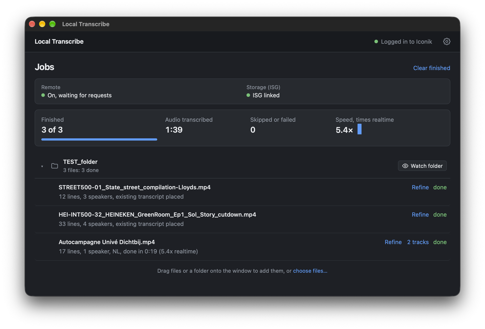
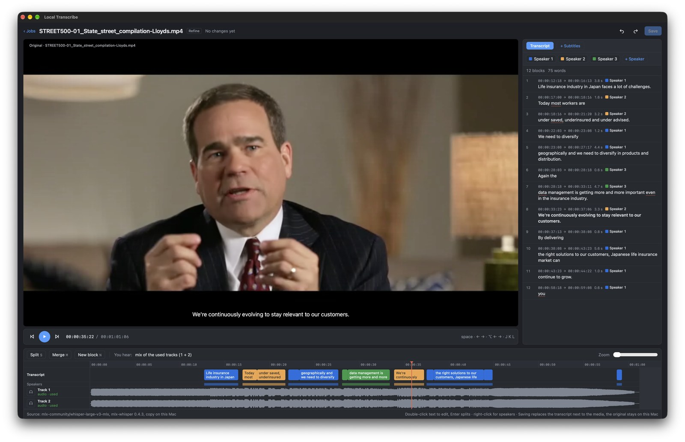
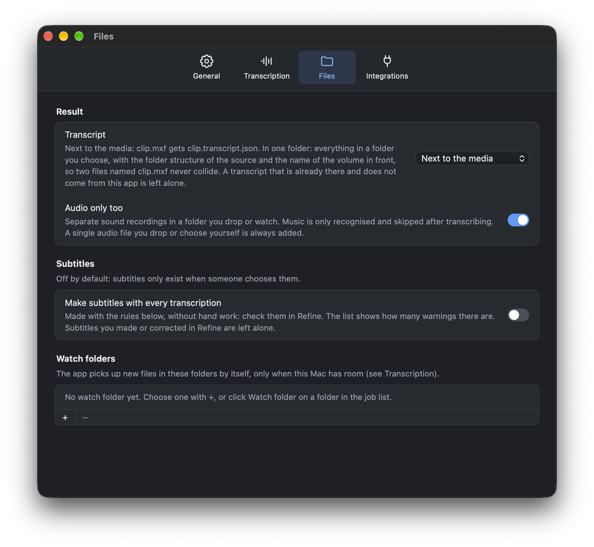
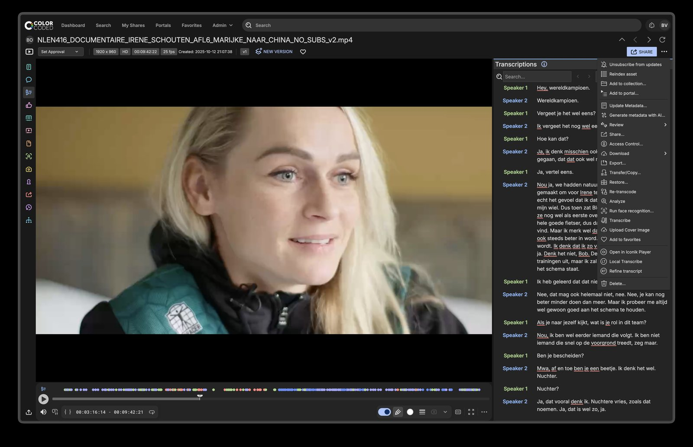
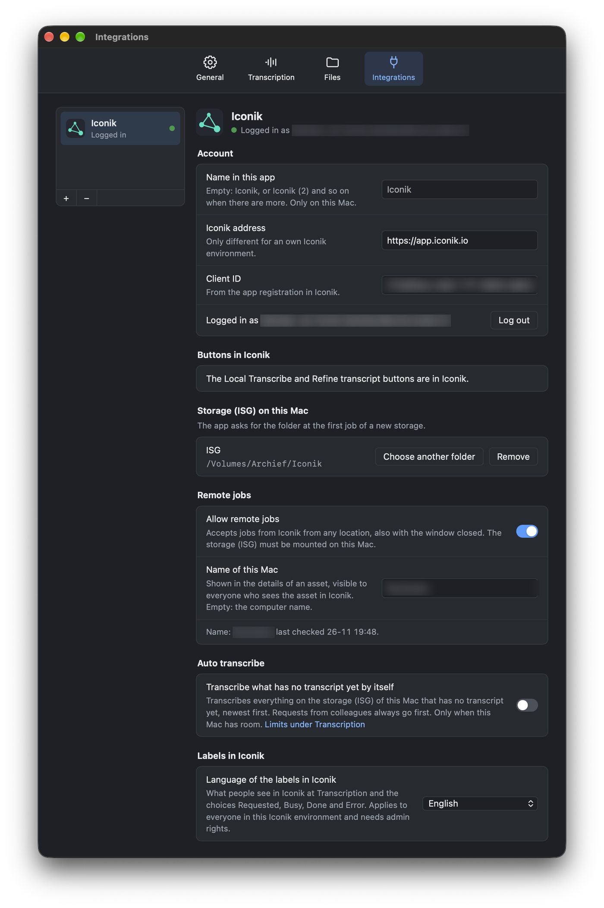
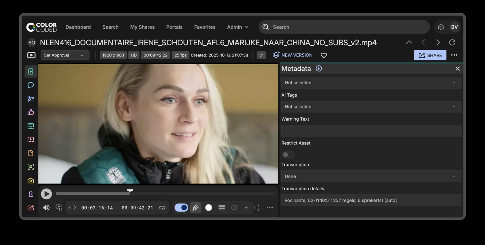

# Local Transcribe

> [!IMPORTANT]
> **New in 0.7: your own files, without Iconik.** The app was called Local Transcribe for Iconik; it now also works on its own.
>
> - **Drop files or a folder** on the window. The transcript lands next to the media as `clip.transcript.json`.
> - **Watch folders:** new files in a folder you pick are transcribed by themselves, when the Mac has room.
> - **Subtitles with every transcription,** if you want them: `.srt` or `.vtt`, made by the same rules as in Refine.
> - **A Settings window,** and several Iconik environments side by side.
>
> 0.7 is a full release: install the `.dmg` from the [latest release](../../releases/latest). The old app can go to the Trash; your settings and login stay.



A Mac app that transcribes video and audio on your own machine, with word timing and speaker labels. Nothing goes to a cloud transcription service.

- **On its own:** drop files or folders on the window, or let it watch a folder. The transcript is written next to the media, in an [open format](docs/format/).
- **With [Iconik](https://www.iconik.io):** pick an asset, a collection or a selection in Iconik and choose **Local Transcribe**. The app reads the file from your mounted storage and writes the transcript back to Iconik as a native transcription.

Made for raw footage from post-production and archives: many audio tracks, whole folders or archives at once, spread over several Macs if you like.



## Features

- **Local files.** Drop files or folders, choose files, or watch folders. See [Local files](#local-files).
- **Refine.** Check a transcript next to the original video and every audio track, fix words, split and merge blocks, rename and reassign speakers, and save the correction next to the media or to Iconik. See [Refine](#refine).
- **Subtitles.** Made from the transcript by rules for reading speed and line length, in Refine or with every transcription. See [Subtitles](#subtitles).
- **Local models.** Whisper large-v3 (MLX on Apple Silicon) for speech, pyannote community-1 for speakers. The speaker model is bundled; the Whisper model (about 3 GB) is downloaded once.
- **Smart track selection.** Skips silence, timecode and duplicate tracks, and when each speaker has their own microphone, reads the speaker from the loudest track.
- **Language per file**, detected from the loudest parts of the recording. Tested with Dutch and English.
- **Filters.** Removes Whisper hallucinations and repetition loops, and skips files without intelligible speech instead of writing nonsense.
- **Safe replacement.** A new run replaces only this app's earlier transcript, and only once the new one succeeded. Transcripts from other sources, files the app did not write and corrections made in Refine are never overwritten.
- **Iconik.** Native transcripts with speakers and word timing, started from buttons in Iconik, and optionally a queue in Iconik that several Macs work through in the background. See [Iconik](#iconik).
- **Updates from inside the app.** Most are a one-click install of about a hundred KB, signed and verified before anything is written.

## Requirements

- A Mac with Apple Silicon, macOS 13 or newer

A full job uses about 9 GB of memory at its peak, whatever the length. 16 GB is enough for jobs you start yourself; for watch folders and Iconik's remote jobs and auto transcribe on a Mac people also work on, 32 GB or more is better. Transcribing runs at about 9 to 12 times realtime on an M3 Max; reading large camera files from network storage is often the slowest step.

## Installation

1. Download the latest `.dmg` from [Releases](../../releases) and drag **Local Transcribe** to Applications.
2. The app is not signed with an Apple Developer ID yet, so macOS blocks the first launch. Open **System Settings, Privacy & Security** and click **Open Anyway**.
3. Drop a file on the window. That is all for local files; for Iconik, see [Iconik](#iconik).

Coming from **Local Transcribe for Iconik**: the new app asks once whether the old one may go to the Trash. Settings, the Iconik login, transcripts and corrections stay where they are. After installing a new `.dmg`, macOS asks for your keychain password when the app starts: choose **Always Allow**. With **Allow** it asks twice.

The `.dmg` contains a step-by-step guide with screenshots in English and Dutch; the same guides are in [`docs/`](docs/).

## Local files



- **Adding.** Drop files or a folder on the window, or use **Choose files…**. A folder shows as a group in the list with all video and audio in it and its subfolders (audio-only files too, unless **Audio only too** is off under Settings › Files).
- **Where the transcript goes.** `clip.mov` gets `clip.transcript.json` next to it, or in one folder you pick under Settings › Files, with the same folder structure so two files called `clip.mov` do not clash. When `clip.mov` and `clip.wav` sit side by side, the second gets `clip.wav.transcript.json`.
- **Watch folders.** The eye button on a group, or **+** under Settings › Files, makes the app pick up new files in that folder by itself: one at a time, newest first, after the file has not changed for 15 seconds, and only when the Mac has room (the same rule as Iconik's [auto transcribe](#iconik-auto-transcribe)). A finished file you move out of the folder turns grey at the bottom of its group, so a watch folder works as an inbox. **Pause** on the group stops it for now: nothing is added and what is waiting does not start, until **Resume**, also after a restart. A job that is running finishes.
- **Cannot write.** On a read-only disk, a locked card or a folder without permission, the app says so before it starts, with **Choose another place…**. The place is remembered for that watch folder or disk. When writing fails during a job, the transcript is kept and written once you pick a place.
- **The same file elsewhere.** The app knows a file by a fingerprint of its content, not by its path. A copy, a moved file or a renamed one gets the transcript the Mac already has, without transcribing again.
- **Never overwritten.** A `clip.transcript.json` in another format, or one that belongs to another file, is left alone and the job is skipped.
- **Removing.** **Also remove from this Mac…** on a job can also move the transcript and subtitles next to the media to the Trash: only what the app wrote itself and that did not change since. On a disk without a Trash, such as a network share, the file stays unless you choose **Delete anyway…**. The media file always stays.

The transcript format is described in [`docs/format/`](docs/format/), with a JSON Schema and examples, so other programs can read it.

## Refine

Refine opens a transcript in the app window: the original on the left, the blocks on the right, and a timeline with the text blocks, the speakers and every audio track as a waveform. Open it with **Refine** on a finished job.

- **Playback** straight from the file. WebKit cannot play most camera formats, so the app converts short pieces with its own ffmpeg while you watch. Space, the arrow keys and J K L work as in an editor; the headphone button plays a single track.
- **Text.** Double-click a block to type. Unchanged words keep their timing; changed words take the time of what they replace and count as checked. Enter splits at the cursor, Backspace at the start merges, cmd+Enter keeps, Esc cancels.
- **Timeline.** S splits at the playhead, M merges with the next block, N adds a block. Drag the edges of a block to adjust its timing.
- **Speakers.** Rename them in the speaker bar. Right-click selected words to move them to another speaker (the block is split), or right-click a block to move all of it.
- **Saving.** Changes are kept as a draft on the Mac, with undo and redo. **Save** writes the correction next to the media. The original stays on the Mac and **Put original back** restores it.
- **Spelling.** The edit field checks spelling in the transcript's language while you type, and the macOS Writing Tools work in it.

A new transcription skips a corrected file; put the original back first to transcribe again. The job list shows **Refined** and **Draft**.

### Subtitles

A transcript block is as long as someone talks; a subtitle has to be readable. **+ Subtitles** in Refine makes subtitles from the transcript as a second layer, and saves them as `.srt`, `.vtt` or both. The transcript itself does not change.

- **Rules.** A preset, or your own values: characters per line, lines, shortest and longest duration, the gap between subtitles and the reading speed. There is no single standard, so the presets are the two common ones: online and streaming (42 characters) and television with teletext (37 characters).
- **Fitting.** Short sentences of the same speaker go together when there is no pause between them, and a subtitle that goes too fast stays on screen in the silence after it. The text is never shortened; the window counts how many subtitles are still too fast before you make them.
- **Where the file goes.** Next to the media (`clip.mxf` gets `clip.srt`), or another place you pick. A file the app did not write itself, or that was changed afterwards, is not overwritten unless you pick it yourself.
- **Editing.** The Subtitles tab uses the same editor as the transcript, on its own lane above it. Orange is faster than the reading speed, red is unreadable or does not fit the rules. Shorten the text, split and merge, drag the edges; **Save** writes the file again and **Fit** applies merging and lingering again without touching what you changed by hand.
- **Existing subtitles.** An `.srt` or `.vtt` that is already there can be loaded instead. Speakers and word timing come from the transcript where the text matches.
- **With every transcription.** Settings › Files › **Make subtitles with every transcription** (off by default, for local files) makes them right after the transcript, with a preset, as `.srt`, `.vtt` or both, with the transcript, next to the media or in one folder. They are the same subtitles Refine shows; once you change them there, a new transcription leaves them alone. The job list says how many have a warning.

Subtitles only exist when you make them in Refine or turn on that setting. When the transcript changes afterwards, the subtitles stay and say so. The job list shows **Subtitles**; click it to open them.

## Iconik

Everything in this section is only needed when you use [Iconik](https://www.iconik.io). Local files work without it.

With Iconik the app writes its transcripts back as native Iconik transcriptions, through the Iconik transcription API, with speakers and word timing, like any other transcript in Iconik. Two Custom Actions start it from Iconik: **Local Transcribe** (assets, collections, selections) and **Refine transcript** (assets). The app reads the file from the Iconik storage mounted on the Mac; nothing is downloaded from Iconik.



### Iconik: requirements

- An Iconik environment: `app.iconik.io` by default; another address can be set under Settings › Integrations (not tested)
- An Iconik admin for the one-time setup
- The Iconik storage (ISG) mounted on the Mac that runs the app

### Iconik: connecting

1. An Iconik admin creates an application under **Admin, Application tokens, New application**: type **Browser or device app**, redirect URI `http://localhost:8765/oauth/callback`, scopes `assets:read`, `assets:write`, `collections:read`, `user_impersonation`.
2. In the app, open **Settings › Integrations**, enter the Client ID, sign in to Iconik and click **Add the buttons to Iconik** when the app asks. That is needed once per Iconik environment.

The app keeps your Iconik login in the macOS keychain. Colleagues only install the app, enter the same Client ID and sign in with their own account. **+** under Integrations adds another Iconik environment, each with its own login; several environments are not yet tested with real, separate environments.

The buttons in Iconik open the app through an `iconiktranscribe://` link. macOS does not tell an app which page opened such a link, so a web page that knows asset IDs from your environment could start jobs for them. The worst outcome is a new transcript replacing an earlier one from this app; other transcripts and corrections are never touched, and browsers ask before a site opens an app.

### Iconik: Refine and subtitles

- **Refine transcript** in the menu of an asset in Iconik opens it in Refine.
- **Save to Iconik** replaces the transcript in Iconik and reindexes the asset, because Iconik searches older transcripts too. Corrected words count as checked, so Iconik shows them without the red underline. A new transcription skips a corrected asset.
- **Without the storage.** When the original cannot be reached, Refine still opens with the text, the speakers, the draft and saving to Iconik; picture and sound are off, and the waveforms come from what an earlier job kept.
- **Subtitles** are not written to Iconik as a transcript. Saved next to the media with a matching name, Iconik links the `.srt` or `.vtt` to the asset. **Make subtitles with every transcription** is for local files only in this release.

### Iconik: remote jobs

With **Remote jobs** (Settings › Integrations › Iconik) a Mac picks up requests made in Iconik, from any location, and processes them in the background, as the account signed in on that Mac. Starting jobs from the Custom Action works as before.



Iconik is the queue. The app creates the metadata fields `local_transcribe_status` (Requested, In progress, Done, Failed) and `local_transcribe_info`, and a metadata view. Add the fields to a view your team uses and set the status to Requested on an asset, or on a collection through Update Metadata to request everything in it. Labels can be Dutch or English (**Language of the labels in Iconik**); stored values are always English.



- A Mac checks once a minute and claims one asset at a time. Tested with two Macs on one account: they split the queue without double work, and an asset of a Mac that stops, sleeps or loses its storage goes to the other. More Macs and separate accounts are not tested yet.
- Problems with the Mac (storage not mounted, signed out, offline) put the asset back, up to three attempts, and pause that Mac for ten minutes; **Resume now** lifts the pause. Problems with the asset itself fail straight away, with the reason in the details field.
- With remote jobs on, the app stays in the menu bar. **Open at login** starts it hidden. Quitting during a job offers **After this job**.
- The details field names the Mac that did the work, for everyone who sees the asset. By default that is the computer name, which often holds a person's name; **Name of this Mac** sets another one.

### Iconik: auto transcribe

With **Auto transcribe** a Mac also works through everything on its storage that has no status and no transcript yet: newest first, video up to an hour, audio when **Audio too** is on. Requests always come first, and several Macs share the work.

It only starts a job when there is room: on mains power, at least 12 GB of memory free, and CPU and GPU each below 40% over the last minutes. So it runs while someone does light work on the Mac and steps aside during editing or rendering; the status strip and the menu bar say what it waits for. It watches the storage every 30 seconds and pauses when it is gone. While it is on and the Mac is on mains power, the Mac stays awake. Automatic jobs carry an Auto label in the app and `[auto]` in Iconik. The limits are under Settings › Transcription.

## Updates

The app checks GitHub Releases every six hours and shows a banner when there is a newer version.

- **Code updates** (most releases): a small signed zip with the app's code. **Install** downloads it, checks an Ed25519 signature and a checksum per file, waits until no job runs and restarts. Updates live next to the app in `~/Library/Application Support/Local Transcribe for Iconik/code/`, so the app's own signature stays valid; if one fails to start, the app falls back to the code in the bundle. The app checks the signed zip again at every start and runs the code from that zip in memory, so changing the unpacked files does nothing.
- **Full updates** (new Python, packages, ffmpeg, models, or a new name as in 0.7) need the new `.dmg`; the banner then links to the download page.

The folders in Application Support and Logs keep the name Local Transcribe for Iconik, so nothing has to move when the app's name changes.

## Privacy

The app connects to Iconik (as the signed-in user) when you use it, to Hugging Face once for the Whisper model, and to GitHub for updates. Audio, transcripts and file names never leave your Mac, except as the transcript written to your own Iconik environment. Telemetry of the bundled libraries is switched off. The local receiver only answers on 127.0.0.1, and only to the app itself: its window gets a session at start, so other programs and other users on the Mac cannot read the job list, your name or transcripts from it.

The log (`~/Library/Logs/Local Transcribe for Iconik/serve.log`) holds file names and asset titles. It starts a new file after a week or 2 MB and keeps one older file for at most a week; **Also remove from this Mac…** offers to clear it. The transcript next to the media holds the media's file name, never its path.

## How it works

```
Files and folders          Iconik (browser)
(drop, choose, watch)      --Custom Action--> iconiktranscribe:// link
        |                                |
        v                                v
         Local Transcribe (one app, one process)
         - receiver on 127.0.0.1:8765 and the job queue
         - connectors: local files, Iconik (one or more environments)
         - ffmpeg: reads and analyses all audio tracks
         - Whisper large-v3 (MLX) + pyannote (PyTorch, Metal)
         - Refine: player, timeline and editor in the app window
        |                                |
        v                                v
clip.transcript.json        Iconik transcription API
(+ .srt / .vtt)             (properties + segments)
```

The app is Python with a small native launcher, so it runs as one Mac app with its own name and icon. The window is a WebKit view (pywebview) on the local receiver. Everything macOS-specific sits behind one layer (`system.py`), and the engine behind one interface (`engine.py`), so other platforms and engines are additions, not rewrites.

## Building from source

```
bash scripts/build_python.sh    # Python 3.12 with the packages from uv.lock, hash-checked (needs uv)
bash scripts/build_ffmpeg.sh    # LGPL build of ffmpeg and ffprobe
bash scripts/build_bundle.sh    # build/Local Transcribe.app
bash scripts/build_dmg.sh       # dist/Local Transcribe.dmg with the guides
bash scripts/build_update.sh    # signed code update in dist/
bash scripts/run_tests.sh       # all tests, also run by the two build scripts above and on GitHub
```

`build_bundle.sh` expects the pyannote speaker model in `~/Library/Application Support/Local Transcribe for Iconik/models/speaker-diarization-community-1` (from [Hugging Face](https://huggingface.co/pyannote/speaker-diarization-community-1), after accepting its terms). Releasing is described in [`docs/RELEASING.md`](docs/RELEASING.md).

| Path | Purpose |
| --- | --- |
| `app/main.py`, `app_shell.py` | Boot layer: picks the bundled code or a verified update, shell version and public update key |
| `app/app_main.py` | The app: window, menu bar, links from Iconik, dropping files, quitting |
| `app/serve.py` | Local receiver, job queue, watch folders, sign-in, Custom Actions |
| `app/transcribe.py` | Entrance to the engine parts and the command line; holds the version number |
| `app/base.py`, `settings.py` | Shared basics (paths, log, language) and every setting in one schema |
| `app/system.py`, `platform_mac.py` | What differs per operating system, with the Mac as the one implementation |
| `app/items.py`, `jobs.py`, `pipeline.py` | The identity of a file or asset, the job list, and one job from start to end |
| `app/audio.py`, `speakers.py`, `filters.py`, `engine.py`, `whisper_mlx.py` | The engine: audio tracks, speakers, filters, the engine interface and Whisper on MLX |
| `app/connectors.py`, `local_files.py`, `iconik.py` | The form of a connector, and the two connectors: local files and Iconik |
| `app/iconik_api.py`, `iconik_queue.py`, `worker.py`, `keychain.py` | Iconik sign-in and client, the queue in Iconik, remote jobs, the login in the keychain |
| `app/transcript.py` | The app's own transcript model and file format |
| `app/refine.py`, `refine.html` | Refine: player pieces, waveforms, drafts, saving and restoring |
| `app/subtitles.py` | Subtitles: dividing a transcript by rules, fitting, warnings, reading and writing `.srt` and `.vtt` |
| `app/resources.py`, `updater.py` | The room check, and code updates |
| `app/ui.html`, `settings.html` | The job window and the Settings window, in English and Dutch |
| `docs/format/` | The transcript format: explanation, JSON Schema, examples |
| `scripts/`, `tools/` | Build scripts, the native launcher, measuring and probe scripts, update signing |
| `tests/` | Tests for every part above, and a browser test of the window against a fake Iconik |

Logs: `~/Library/Logs/Local Transcribe for Iconik/serve.log`.

## Roadmap

- Translation, as a second transcript in the target language
- Learn from corrections: better results per language and dialect, so users can improve untested languages themselves
- A word list per project or collection, to help Whisper with names and jargon
- Documentation as a searchable site, with a public roadmap
- Assets with separate audio files (OP-Atom, P2, Avid media)
- Test the shared queue with more than two Macs and with separate Iconik accounts
- Sign and notarize the app, for fully automatic updates
- A one-click button in Iconik for remote jobs (needs an endpoint Iconik can reach)

## Credits and licenses

This project is released under the [MIT license](LICENSE). It builds on Whisper (OpenAI), MLX and mlx-whisper (Apple), pyannote (pyannoteAI), PyTorch, ffmpeg and pywebview. See [THIRD_PARTY_NOTICES.md](docs/THIRD_PARTY_NOTICES.md).

Not affiliated with or endorsed by Iconik or Backlight. Iconik is a trademark of its owner.

Made by [Bastiaan van Oorde](https://github.com/ColorcodedNL), developed with AI assistance.
