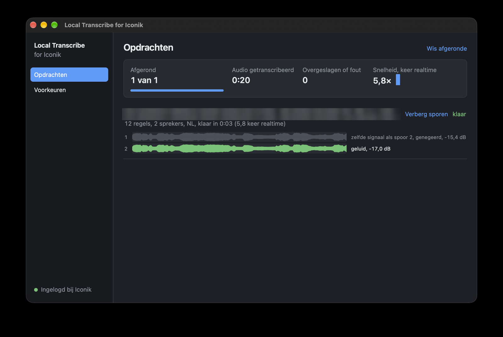
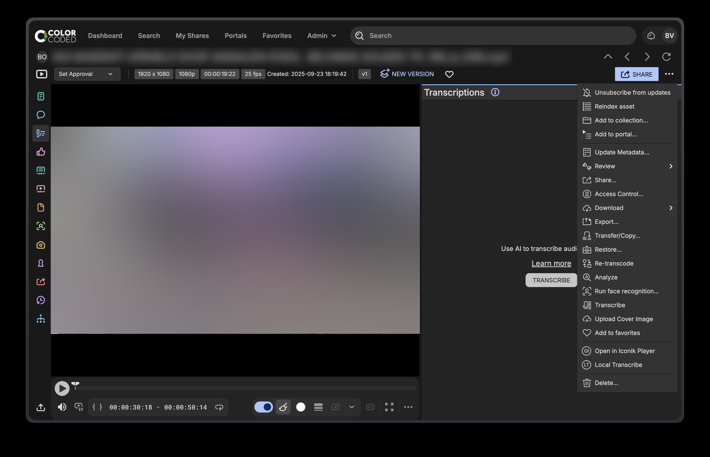
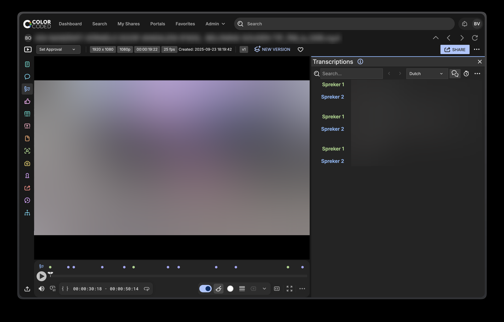

# Local Transcribe for Iconik

A Mac app that transcribes assets from [Iconik](https://www.iconik.io) on your own machine and writes the result back to Iconik as native transcriptions, with word timing and speaker labels.

You start it from Iconik itself: pick an asset, a collection or a selection, and choose **Local Transcribe**. The app reads the source file from your mounted storage, transcribes it locally and sends the transcript back. Nothing goes to a cloud transcription service.



## Features

- **Native Iconik transcripts.** Written through the Iconik transcription API, so they show up under Transcriptions with speakers and word timing, like any other transcript in Iconik. No `.srt` sidecars.
- **Started from Iconik.** The app adds a "Local Transcribe" Custom Action to your Iconik environment when you connect it, for assets, collections and multi-selections.
- **Local models.** Whisper large-v3 (via MLX on Apple Silicon) for speech, pyannote community-1 for speaker detection. The speaker model is bundled; the Whisper model (about 3 GB) is downloaded once on first use.
- **Smart track selection.** For camera and multi-track files the app looks at every audio track: it skips silence, timecode and duplicate tracks, and when speakers each have their own microphone, it reads the speaker from the loudest track.
- **Language per asset.** Detected from the loudest parts of the recording, not just the first 30 seconds. Tested with Dutch and English.
- **Filters.** Removes Whisper hallucinations and repetition loops, and skips files without intelligible speech instead of writing nonsense.
- **Safe replacement.** Running it again replaces only the transcript this app made earlier. Transcripts from other sources are never touched, and the old transcript is only removed once the new one succeeded.
- **Efficient on collections.** While one asset is being transcribed, the audio of the next one is already read from the network storage.
- **Remote jobs (optional).** Request a transcript from the Iconik browser and let a Mac that is on in the background do it, without an extra Iconik login. Off by default. See [Remote jobs](#remote-jobs).
- **Updates from inside the app.** A banner offers new versions; most are a one-click install of a few dozen KB, signed and verified before anything is written.





## Requirements

- A Mac with Apple Silicon, macOS 13 or newer
- An Iconik environment on `app.iconik.io`, and an Iconik admin for the one-time setup
- The Iconik storage (ISG) mounted on the Mac that runs the app

## Installation

1. Download the latest `.dmg` from [Releases](../../releases).
2. Drag **Local Transcribe for Iconik** to Applications.
3. The app is not signed with an Apple Developer ID yet, so macOS blocks it on first launch. Open **System Settings, Privacy & Security** and click **Open Anyway**.

The `.dmg` contains a step-by-step guide with screenshots, in English and Dutch. The same guides are in [`docs/`](docs/).

### One-time setup in Iconik

1. An Iconik admin creates an application under **Admin, Application tokens, New application**: type **Browser or device app**, redirect URI `http://localhost:8765/oauth/callback`, scopes `assets:read`, `assets:write`, `collections:read`, `user_impersonation`.
2. Enter the resulting Client ID in the app and sign in to Iconik.
3. Click **Add the button to Iconik** when the app asks. This creates the Custom Actions for everyone in that environment.

Colleagues skip steps 1 and 3: they install the app, enter the same Client ID and sign in with their own account.

## Updates

The app checks GitHub Releases every six hours. When a newer version exists, a banner appears at the top of the window.

- **Code updates** (most releases) are a small signed zip with the app's Python code. Click **Install**; the app downloads it, verifies an Ed25519 signature and a checksum per file, waits until no job is running, and restarts itself.
- **Full updates** (a new Python, new packages, a new ffmpeg or models) need the new `.dmg`. The banner then offers the download page instead.

Code updates are stored next to the app (`~/Library/Application Support/Local Transcribe for Iconik/code/`), never inside it, so the app's own code signature stays valid. If an update fails to start, the app notes that version as bad and starts again with the code that came in the app bundle. Nothing is installed without a valid signature from the key whose public half is built into the app (`app_shell.py`).

## Remote jobs

Not everyone has a Mac with enough memory for fast transcripts. With **Allow remote jobs** (Preferences) a Mac picks up requests made in the Iconik browser, from any location, and processes them in the background. The normal workflow, started from the Custom Action, does not change.

How it works: Iconik is the queue. The app creates two metadata fields, `local_transcribe_status` (`aangevraagd`, `bezig`, `klaar`, `fout`) and `local_transcribe_info`, and a metadata view called "Local Transcribe". Add the two fields to a metadata view your team uses. To request a transcript, set the status to `aangevraagd` on an asset. The Mac checks once a minute, claims the asset, runs the usual engine and writes the outcome back.

- It uses the Iconik account that is signed in on that Mac, so no extra licence is needed. It only sees assets that account can see, and transcripts appear under that account.
- Problems with the Mac (storage not mounted, not signed in, no internet) put the asset back in the queue, up to three attempts, then `fout` with the reason. The Mac then pauses for ten minutes. Problems with the asset itself are `fout` straight away.
- Claiming is a write, a short wait and a read back, because Iconik has no atomic operation. Fine for one worker; test it with several Macs before relying on it.
- With remote jobs on, the app lives in the menu bar and closing the window hides it. **Open at login** (separate, off by default) starts it hidden at login.
- The storage (ISG) must be mounted on that Mac.

## Privacy

The app connects to:

- **Iconik**, to read asset information and write transcripts, as the signed-in user
- **Hugging Face**, once, to download the Whisper model
- **GitHub**, to check whether a newer version is available and, when you click Install, to download it

Audio, transcripts and file names never leave your Mac except as the transcript written to your own Iconik environment. Usage telemetry of the bundled libraries (pyannote, Hugging Face) is switched off.

## How it works

```
Iconik (browser)  --Custom Action-->  iconiktranscribe:// link
                                              |
                                              v
                           Local Transcribe for Iconik (one app, one process)
                           - receiver on 127.0.0.1:8765, job queue
                           - finds the file on the mounted storage
                           - ffmpeg: reads and analyses all audio tracks
                           - Whisper large-v3 (MLX) + pyannote (PyTorch, Metal)
                                              |
                                              v
                           Iconik transcription API (properties + segments)
```

The app is Python with a small native launcher, so it runs as a single Mac app with its own name and icon in the Dock and in Activity Monitor. The window is a WebKit view (pywebview) on the local receiver.

## Building from source

```
bash build_python.sh    # relocatable Python 3.12 with all packages in build/python (needs uv)
bash build_ffmpeg.sh    # LGPL build of ffmpeg and ffprobe in build/ffmpeg-out
bash build_bundle.sh    # build/Local Transcribe for Iconik.app
bash build_dmg.sh       # dist/Local Transcribe for Iconik.dmg with the guides
bash build_update.sh    # dist/code-<version>-shell<N>.zip and .sig, signed with your update key
```

`build_bundle.sh` expects the pyannote speaker model in `~/Library/Application Support/Local Transcribe for Iconik/models/speaker-diarization-community-1`. Download it from [Hugging Face](https://huggingface.co/pyannote/speaker-diarization-community-1) (you need to accept its terms there).

| File | Purpose |
| --- | --- |
| `main.py` | Boot: picks the bundled code or the newest verified code update, falls back if it fails. Rarely changes |
| `app_shell.py` | Fixed layer: shell version and the public update key. Rarely changes |
| `app_main.py` | The app: receiver, job queue, window, menu bar, Iconik links, quitting, restart after an update |
| `updater.py` | Finds, downloads, verifies and installs code updates |
| `serve.py` | Local receiver, job queue, sign-in, Custom Action check, remote-jobs switch, open at login |
| `worker.py` | Remote jobs: the Iconik queue (fields, claim, retries, pause) |
| `transcribe.py` | The engine: audio tracks, Whisper, speakers, filters, writing to Iconik. Also usable from the command line |
| `ui.html` | The window (jobs and preferences), in English and Dutch |
| `launcher.c` | Native launcher that loads the bundled Python in the app process |
| `setup_actions.py` | Create the Custom Actions from the command line |
| `tools/` | Measuring tools for audio tracks and assets, update signing (`sign_update.py`), `make_manifest.py`, `local_update_test.py` |
| `tests/` | Tests for the boot layer, the updater, the update state in `serve.py`, the remote-jobs queue and its switch |

Logs: `~/Library/Logs/Local Transcribe for Iconik/serve.log`. Each job logs time and memory per stage.

## Roadmap

- Test the shared queue with several Macs, so a whole archive can be transcribed in parallel
- A one-click button in Iconik for remote jobs (needs an endpoint Iconik can reach)
- Sign and notarize the app, which would allow fully automatic updates (Sparkle)
- Native Mac interface in Swift
- Configurable Iconik host for environments other than `app.iconik.io`

## Credits and licenses

This project is released under the [MIT license](LICENSE). It builds on Whisper (OpenAI), MLX and mlx-whisper (Apple), pyannote (pyannoteAI), PyTorch, ffmpeg and pywebview. See [THIRD_PARTY_NOTICES.md](THIRD_PARTY_NOTICES.md).

Not affiliated with or endorsed by Iconik or Backlight. Iconik is a trademark of its owner.

Made by [Bastiaan van Oorde](https://github.com/ColorcodedNL), developed with AI assistance.
