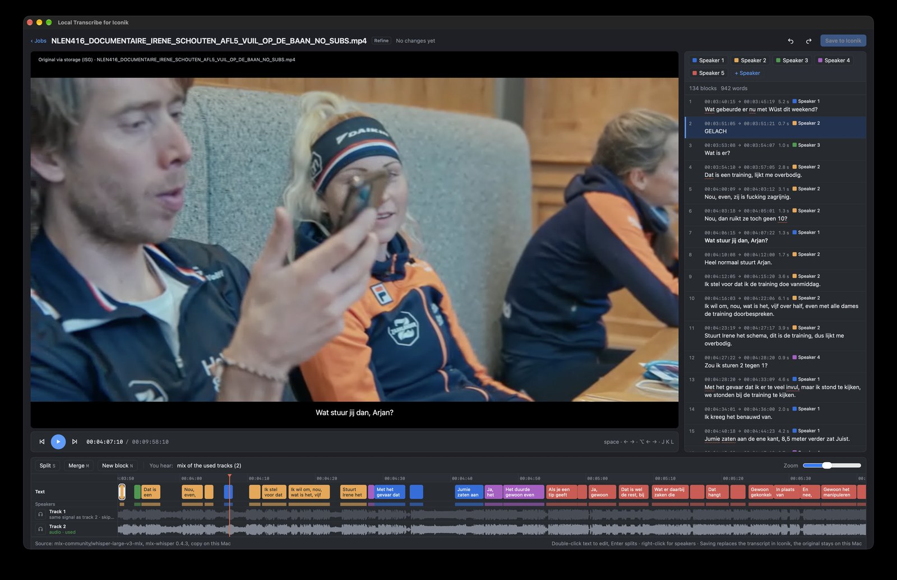
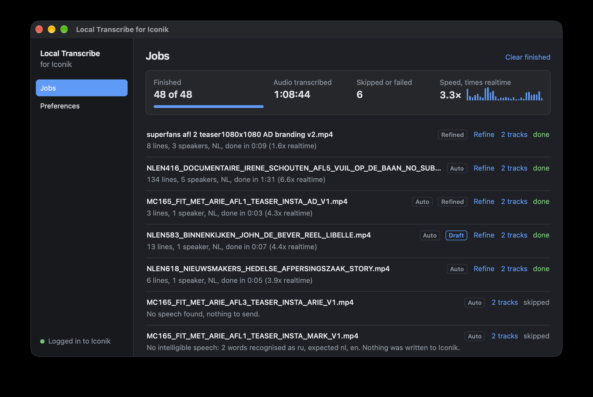
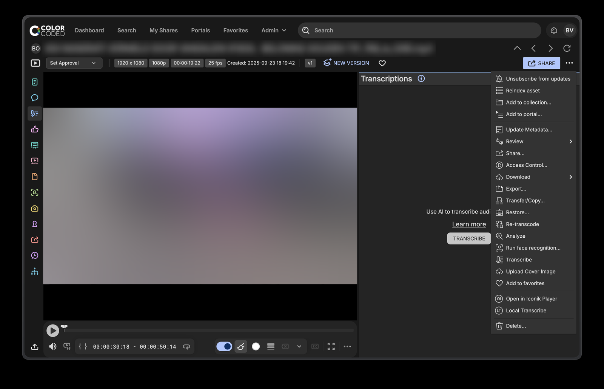
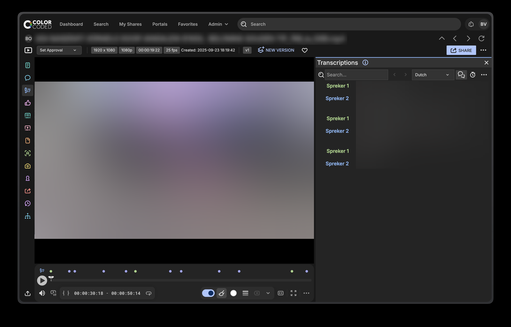
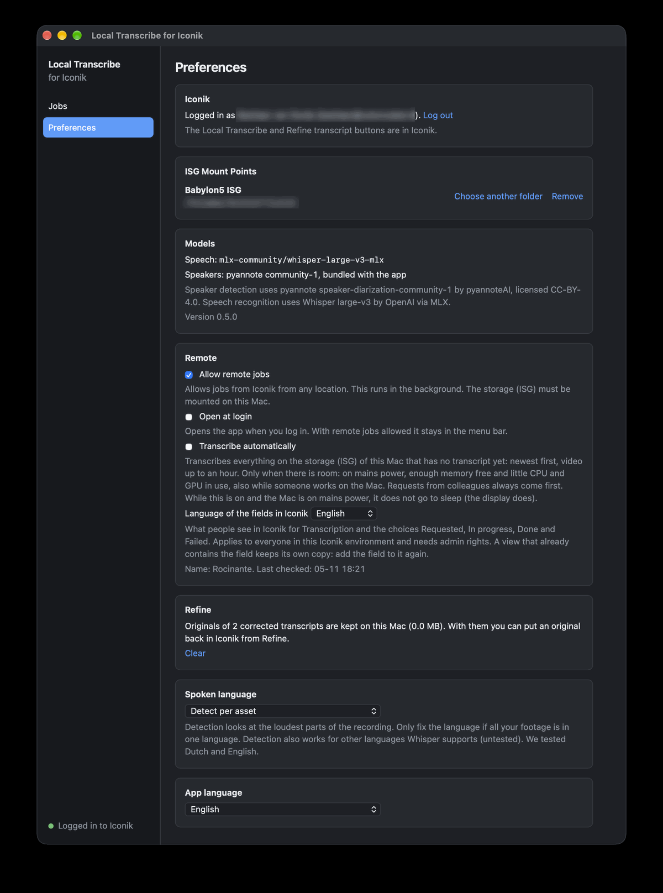

# Local Transcribe for Iconik

> [!IMPORTANT]
> **New in 0.5: Refine, a transcript editor in the app.** Watch the original, see every audio track on a timeline, and fix text and speakers. The correction goes back to Iconik as a native transcript.
>
> - **Edit like text:** double-click a block to type. Enter splits it at the cursor, Backspace at the start merges it with the previous one. Word timing is kept.
> - **Speakers:** rename them, or move selected words or a whole block to another speaker with a right-click.
> - **Safe:** the original stays on your Mac and can be put back; a later transcription never overwrites a correction.
> - **Two ways in:** a Refine button on every finished job, and a Refine transcript button in Iconik.
>
> 0.5.0 is a code update: installed apps offer it with one click. New users take the `.dmg` from the [latest release](../../releases/latest).



A Mac app that transcribes assets from [Iconik](https://www.iconik.io) on your own machine and writes the result back to Iconik as native transcriptions, with word timing and speaker labels. You start it from Iconik: pick an asset, a collection or a selection and choose **Local Transcribe**. The app reads the file from your mounted storage, transcribes it locally and sends the transcript back. Nothing goes to a cloud transcription service.



## Features

- **Native Iconik transcripts.** Written through the Iconik transcription API, with speakers and word timing, like any other transcript in Iconik.
- **Refine.** Check a transcript next to the original video and every audio track, fix words, split and merge blocks, rename and reassign speakers, and save the correction to Iconik. See [Refine](#refine).
- **Started from Iconik.** The app adds two Custom Actions to your Iconik environment: Local Transcribe (assets, collections, selections) and Refine transcript (assets).
- **Local models.** Whisper large-v3 (MLX on Apple Silicon) for speech, pyannote community-1 for speakers. The speaker model is bundled; the Whisper model (about 3 GB) is downloaded once.
- **Smart track selection.** Skips silence, timecode and duplicate tracks, and when each speaker has their own microphone, reads the speaker from the loudest track.
- **Language per asset**, detected from the loudest parts of the recording. Tested with Dutch and English.
- **Filters.** Removes Whisper hallucinations and repetition loops, and skips files without intelligible speech instead of writing nonsense.
- **Safe replacement.** A new run replaces only this app's earlier transcript, and only once the new one succeeded. Transcripts from other sources and corrections made in Refine are never overwritten.
- **Remote jobs and auto transcribe (optional).** Let a Mac in the background handle requests made in Iconik, or work through everything on the storage that has no transcript yet. See [Remote jobs](#remote-jobs).
- **Updates from inside the app.** Most are a one-click install of about a hundred KB, signed and verified before anything is written.





## Requirements

- A Mac with Apple Silicon, macOS 13 or newer
- An Iconik environment on `app.iconik.io`, and an Iconik admin for the one-time setup
- The Iconik storage (ISG) mounted on the Mac that runs the app

A full job uses about 9 GB of memory at its peak, whatever the length. 16 GB is enough for jobs you start yourself; for remote jobs and auto transcribe on a Mac people also work on, 32 GB or more is better. Transcribing runs at about 9 to 12 times realtime on an M3 Max; reading large camera files from network storage is often the slowest step.

## Installation

1. Download the latest `.dmg` from [Releases](../../releases) and drag **Local Transcribe for Iconik** to Applications.
2. The app is not signed with an Apple Developer ID yet, so macOS blocks the first launch. Open **System Settings, Privacy & Security** and click **Open Anyway**.
3. An Iconik admin creates an application under **Admin, Application tokens, New application**: type **Browser or device app**, redirect URI `http://localhost:8765/oauth/callback`, scopes `assets:read`, `assets:write`, `collections:read`, `user_impersonation`.
4. Enter the Client ID in the app, sign in to Iconik and click **Add the buttons to Iconik** when the app asks. That is needed once per Iconik environment.

Colleagues only install the app, enter the same Client ID and sign in with their own account. The `.dmg` contains a step-by-step guide with screenshots in English and Dutch; the same guides are in [`docs/`](docs/).

## Updates

The app checks GitHub Releases every six hours and shows a banner when there is a newer version.

- **Code updates** (most releases): a small signed zip with the app's code. **Install** downloads it, checks an Ed25519 signature and a checksum per file, waits until no job runs and restarts. Updates live next to the app in `~/Library/Application Support/Local Transcribe for Iconik/code/`, so the app's own signature stays valid; if one fails to start, the app falls back to the code in the bundle.
- **Full updates** (new Python, packages, ffmpeg or models) need the new `.dmg`; the banner then links to the download page.

## Remote jobs

With **Allow remote jobs** (Preferences) a Mac picks up requests made in Iconik, from any location, and processes them in the background, as the account signed in on that Mac. Starting jobs from the Custom Action works as before.



Iconik is the queue. The app creates the metadata fields `local_transcribe_status` (Requested, In progress, Done, Failed) and `local_transcribe_info`, and a metadata view. Add the fields to a view your team uses and set the status to Requested on an asset, or on a collection through Update Metadata to request everything in it. Labels can be Dutch or English (Preferences, **Language of the fields in Iconik**); stored values are always English.

- A Mac checks once a minute and claims one asset at a time. Tested with two Macs on one account: they split the queue without double work, and an asset of a Mac that stops, sleeps or loses its storage goes to the other. More Macs and separate accounts are not tested yet.
- Problems with the Mac (storage not mounted, signed out, offline) put the asset back, up to three attempts, and pause that Mac for ten minutes; **Resume now** lifts the pause. Problems with the asset itself fail straight away, with the reason in the details field.
- With remote jobs on, the app stays in the menu bar. **Open at login** starts it hidden. Quitting during a job offers **After this job**.

### Auto transcribe

With **Transcribe automatically** a Mac also works through everything on its storage that has no status and no transcript yet: newest first, video up to an hour, audio when **Audio files too** is on. Requests always come first, and several Macs share the work.

It only starts a job when there is room: on mains power, at least 12 GB of memory free, and CPU and GPU each below 40% over the last minutes. So it runs while someone does light work on the Mac and steps aside during editing or rendering; Preferences and the menu bar say what it waits for. It watches the storage every 30 seconds and pauses when it is gone. While it is on and the Mac is on mains power, the Mac stays awake. Automatic jobs carry an Auto label in the app and `[auto]` in Iconik. The limits are in `config.json` in `~/Library/Application Support/Local Transcribe for Iconik/`.

## Refine

Refine opens a transcript in the app window: the original on the left, the blocks on the right, and a timeline with the text blocks, the speakers and every audio track as a waveform. Open it with **Refine** on a finished job or **Refine transcript** in the menu of an asset in Iconik.

- **Playback** straight from the storage. WebKit cannot play most camera formats, so the app converts short pieces with its own ffmpeg while you watch. Space, the arrow keys and J K L work as in an editor; the headphone button plays a single track.
- **Text.** Double-click a block to type. Unchanged words keep their timing; changed words take the time of what they replace and count as checked, so Iconik shows them without the red underline. Enter splits at the cursor, Backspace at the start merges, cmd+Enter keeps, Esc cancels.
- **Timeline.** S splits at the playhead, M merges with the next block, N adds a block. Drag the edges of a block to adjust its timing.
- **Speakers.** Rename them in the speaker bar. Right-click selected words to move them to another speaker (the block is split), or right-click a block to move all of it.
- **Saving.** Changes are kept as a draft on the Mac, with undo and redo. **Save to Iconik** replaces the transcript and reindexes the asset, because Iconik searches older transcripts too. The original stays on the Mac and **Put original back** restores it.

A new transcription skips a corrected asset; put the original back first to transcribe again. The job list shows **Refined** and **Draft**.

## Privacy

The app connects to Iconik (as the signed-in user), to Hugging Face once for the Whisper model, and to GitHub for updates. Audio, transcripts and file names never leave your Mac except as the transcript written to your own Iconik environment. Telemetry of the bundled libraries is switched off. The local receiver only answers on 127.0.0.1.

macOS does not tell an app which page opened an `iconiktranscribe://` link, so a web page that knows asset IDs from your environment could start jobs for them. The worst outcome is a new transcript replacing an earlier one from this app; other transcripts and corrections are never touched, and browsers ask before a site opens an app.

## How it works

```
Iconik (browser) --Custom Action--> iconiktranscribe:// link
                                            |
                                            v
               Local Transcribe for Iconik (one app, one process)
               - receiver on 127.0.0.1:8765 and the job queue
               - finds the file on the mounted storage
               - ffmpeg: reads and analyses all audio tracks
               - Whisper large-v3 (MLX) + pyannote (PyTorch, Metal)
               - Refine: player, timeline and editor in the app window
                                            |
                                            v
               Iconik transcription API (properties + segments)
```

The app is Python with a small native launcher, so it runs as one Mac app with its own name and icon. The window is a WebKit view (pywebview) on the local receiver.

## Building from source

```
bash scripts/build_python.sh    # Python 3.12 with the packages from uv.lock, hash-checked (needs uv)
bash scripts/build_ffmpeg.sh    # LGPL build of ffmpeg and ffprobe
bash scripts/build_bundle.sh    # build/Local Transcribe for Iconik.app
bash scripts/build_dmg.sh       # dist/Local Transcribe for Iconik.dmg with the guides
bash scripts/build_update.sh    # signed code update in dist/
bash scripts/run_tests.sh       # all tests, also run by the two build scripts above and on GitHub
```

`build_bundle.sh` expects the pyannote speaker model in `~/Library/Application Support/Local Transcribe for Iconik/models/speaker-diarization-community-1` (from [Hugging Face](https://huggingface.co/pyannote/speaker-diarization-community-1), after accepting its terms). Releasing is described in [`docs/RELEASING.md`](docs/RELEASING.md).

| Path | Purpose |
| --- | --- |
| `app/main.py`, `app_shell.py` | Boot layer: picks the bundled code or a verified update, shell version and public update key |
| `app/app_main.py` | The app: window, menu bar, Iconik links, quitting |
| `app/serve.py` | Local receiver, job queue, sign-in, Custom Actions, preferences |
| `app/transcribe.py` | The engine: audio tracks, Whisper, speakers, filters. Also usable from the command line |
| `app/transcript.py` | The app's own transcript model and file format |
| `app/iconik.py` | The Iconik connector: open an asset, find the media, write and read transcripts |
| `app/refine.py`, `refine.html` | Refine: player pieces, waveforms, drafts, saving and restoring |
| `app/worker.py`, `resources.py` | Remote jobs and auto transcribe, and the room check |
| `app/updater.py` | Code updates |
| `app/ui.html` | The window (jobs and preferences), in English and Dutch |
| `scripts/`, `tools/` | Build scripts, the native launcher, measuring and probe scripts, update signing |
| `tests/` | Tests for every part above, and a browser test of the window against a fake Iconik |

Logs: `~/Library/Logs/Local Transcribe for Iconik/serve.log`.

## Roadmap

- Spelling check in Refine, with the macOS spelling checker
- Export to `.srt` and `.vtt`, also for Iconik assets
- A standalone mode: import local files or watch a folder, without Iconik
- Translation, as a second transcript in the target language
- Learn from corrections: better results per language and dialect, so users can improve untested languages themselves
- Documentation as a searchable site, with a public roadmap
- Assets with separate audio files (OP-Atom, P2, Avid media)
- Test the shared queue with more than two Macs and with separate Iconik accounts
- Sign and notarize the app, for fully automatic updates
- A one-click button in Iconik for remote jobs (needs an endpoint Iconik can reach)
- Native Mac interface in Swift
- Configurable Iconik host for environments other than `app.iconik.io`

## Credits and licenses

This project is released under the [MIT license](LICENSE). It builds on Whisper (OpenAI), MLX and mlx-whisper (Apple), pyannote (pyannoteAI), PyTorch, ffmpeg and pywebview. See [THIRD_PARTY_NOTICES.md](docs/THIRD_PARTY_NOTICES.md).

Not affiliated with or endorsed by Iconik or Backlight. Iconik is a trademark of its owner.

Made by [Bastiaan van Oorde](https://github.com/ColorcodedNL), developed with AI assistance.
